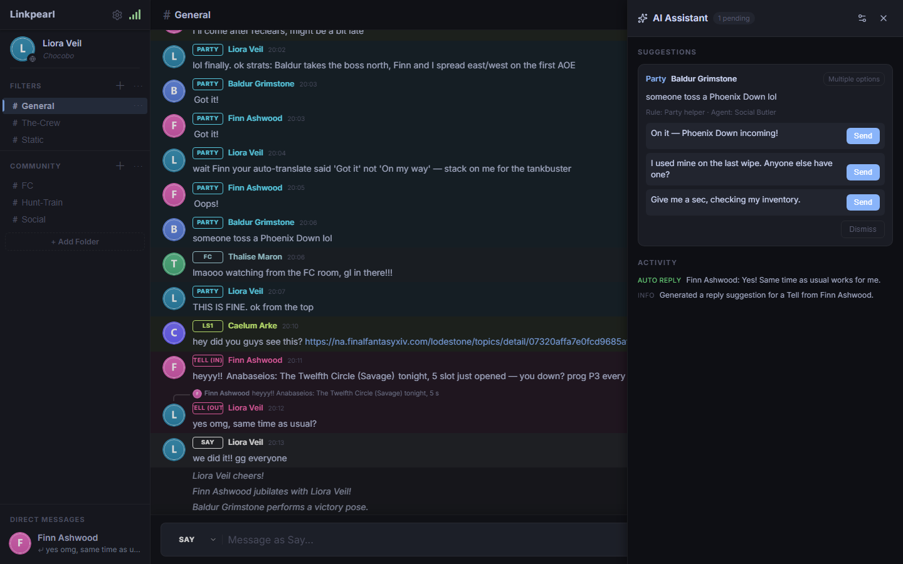
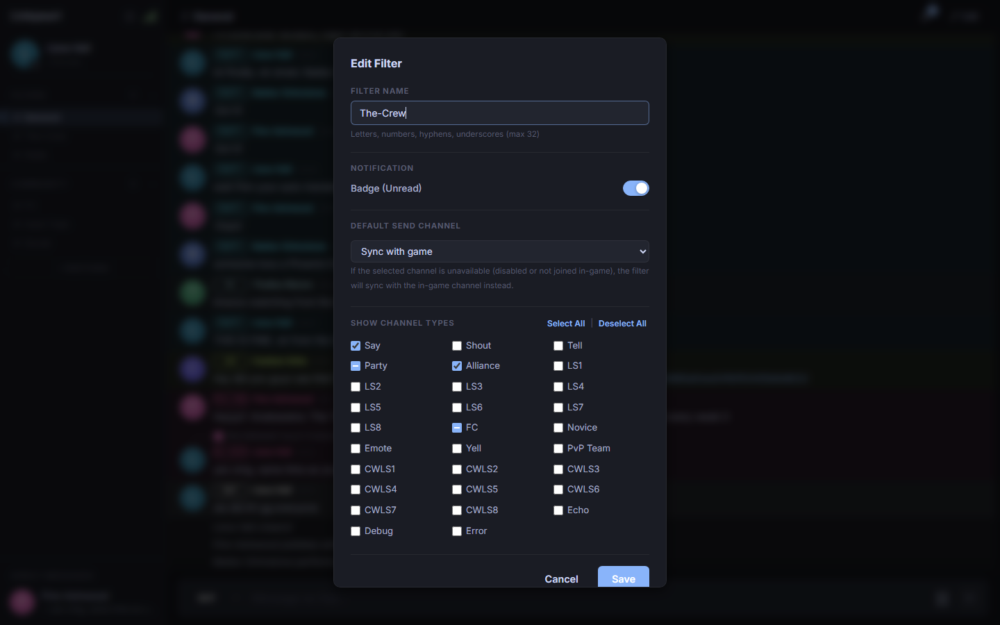
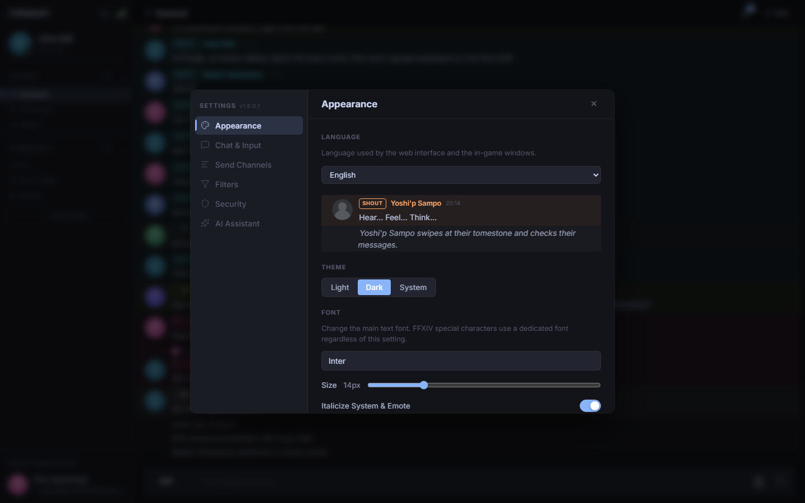
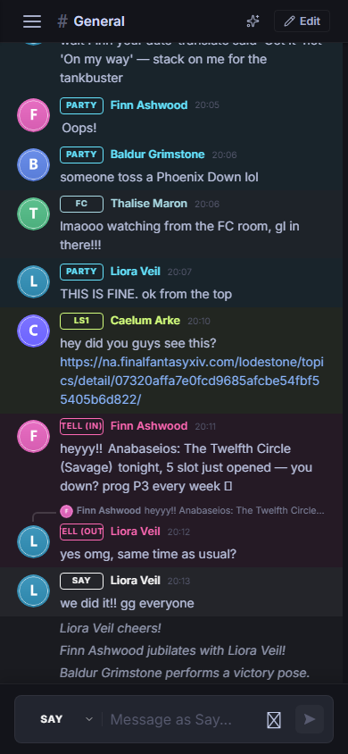

<p align="center">简体中文 | <a href="README.en.md">English</a></p>

<div align="center">
  
  <h1>Linkpearl</h1>
  <p><strong>把 FFXIV 聊天带到浏览器，并内置 AI 助手。</strong></p>
  <p>
    <a href="https://github.com/yjkz/Linkpearl/releases"></a>
    <a href="https://github.com/yjkz/Linkpearl/actions/workflows/release.yml"></a>
  </p>
</div>

Linkpearl 在 FFXIV 游戏内运行一个轻量 Web 服务器。它把游戏聊天实时推送到任意浏览器，让你不切回游戏也能回复；同时内置 OpenAI 兼容的 AI 助手，可以在你指定的频道自动回复、给出多个回复选项，或生成可编辑的回复建议。



## 功能亮点

### 随时随地聊天

- 通过 Server-Sent Events 实时推送，无需轮询
- 支持 FC、LS/CWLS 1–8、小队、私聊、说话、喊话、呼喊、团队、新手频道等
- 自定义过滤器：文件夹、拖拽排序、未读角标、每个过滤器独立发送频道
- 私聊模式：固定回复对象、最近私聊历史
- 可选发送队列：发送前短暂倒计时，取消误发
- 表情选择器（搜索/最近使用）与 FFXIV 特殊符号选择器
- 受信任站点的链接预览（Lodestone、YouTube、Twitter/X、Twitch 等）
- 浏览器访问密码保护

### AI 助手

- 兼容任何 OpenAI Chat Completions 接口（OpenAI、DeepSeek、智谱、Ollama、LM Studio 等）
- 多个可自定义 Agent，每个可设置系统提示词、模型覆盖、温度和最大 Token
- 按频道配置触发规则，支持冷却和每分钟频率限制
- 三种回复模式：
  - **自动回复** — 生成后立即发送
  - **多选项** — 给出多个候选回复，点击发送
  - **回复建议** — 生成一条建议，可编辑后发送
- 纯对话模型，不调用工具、不执行隐藏操作
- 建议与活动日志同时显示在浏览器面板和游戏内 `/linkpearl ai` 窗口

### 一个界面，两种语言

- 浏览器与游戏内窗口共享同一个语言设置
- **默认中文**，可随时切换 English
- 选择保存在插件配置中，两端实时同步

## 截图

| 过滤器与频道选择 | 外观与语言 |
|---|---|
|  |  |

<p align="center">
  
</p>

## 安装

### 自定义 Dalamud 仓库

Linkpearl 通过自己的插件仓库分发：

```
https://raw.githubusercontent.com/yjkz/Linkpearl/main/pluginmaster.json
```

1. 游戏内执行 `/xlsettings` 打开 Dalamud 设置。
2. 打开 **Experimental** 标签。
3. 把上面的 URL 加到 **Custom Plugin Repositories**（每行一个），保存。
4. 打开 **Dalamud Plugin Installer**，搜索 **Linkpearl** 并安装。

安装器条目包含完整说明、图标和截图。

### 本地开发

本地开发不需要仓库：把构建输出目录（例如 `bin\Debug`）加入 Dalamud Experimental 设置中的 **Dev Plugin Locations**。该目录需要包含 `Linkpearl.dll`、`Linkpearl.json` 和 `dist\` 前端目录。

## 初始设置

1. 使用 `/linkpearl` 打开插件设置。
2. 在 **安全** 中设置 4–8 位数字密码。
3. 如果 Web 服务器未启动，先启动它，然后在浏览器打开显示的地址：

   ```
   http://localhost:3000
   ```

4. 输入密码。聊天会立即出现在页面中，回复也会发送回游戏。

同一局域网内的其他设备可以访问 `http://<本机局域网 IP>:3000`。插件设置窗口会列出可用的 IPv4 地址。

## AI 配置

1. 打开 `/linkpearl ai` 或浏览器中的 AI 面板。
2. 打开 **设置 → AI 助手**。
3. 填写 **API Base URL**、**API Key** 和默认模型。
4. 创建一个或多个 **Agent**，为它们设置系统提示词。
5. 创建 **触发规则**，绑定 Agent、选择频道和回复模式。
6. 保存。**测试连接** 按钮会先保存当前设置，再验证服务商。

自动回复按规则限流（冷却时间 + 每分钟上限），并且会忽略你自己发送的消息，避免循环回复。API Key 只保存在本地插件配置中，不会发送到浏览器。

## 命令

| 命令 | 作用 |
|---|---|
| `/linkpearl` | 开关设置窗口 |
| `/linkpearl ai` | 开关 AI 助手窗口 |
| `/linkpearl start` | 启动 Web 服务器 |
| `/linkpearl stop` | 停止 Web 服务器 |
| `/linkpearl help` | 显示命令帮助 |

## 从源码构建

依赖：

- .NET 10 SDK（项目使用 `Dalamud.NET.Sdk/15.0.0`）
- Node.js 20+ 与 npm
- Dalamud 参考程序集（`DALAMUD_HOME` 或本地 XIVLauncher 安装）

```bash
# 插件（同时构建前端并把 dist/ 拷入输出目录）
dotnet build Linkpearl.sln

# 仅前端
cd Http/Frontend
npm install
npm run build
npm test
npm run lint
```

构建产物位于 `bin\Debug`（或 `bin\Release`），包含 `Linkpearl.dll`、`Linkpearl.json` 和 `dist\`，可直接加载。

## 发布

1. 提升 `Linkpearl.csproj` 中的 `<Version>` 并提交到 `main`。
2. 推送同名 tag，例如 `vX.Y.Z`。
3. `Release` 工作流会执行前端 lint/test/build、构建插件、发布 `Linkpearl.zip` 到 GitHub Release，并更新 `pluginmaster.json`。

## 致谢

Linkpearl 是原 [ChatAnywhere](https://github.com/twelvehouse/ChatAnywhere) 项目的独立衍生版本，原作者为 twelvehouse。聊天中继、浏览器界面和插件基础都源自该项目，在此表示感谢。

Linkpearl 也离不开这些项目：

| 项目 | 作用 |
|---|---|
| [ChatAnywhere](https://github.com/twelvehouse/ChatAnywhere) | Linkpearl 基于的原项目 |
| [ChatTwo](https://github.com/Infiziert90/ChatTwo) | 聊天处理与 UI 思路的早期灵感 |
| [Dalamud](https://github.com/goatcorp/Dalamud) | 插件框架与 FFXIV 游戏 API |
| [NetStone](https://github.com/xivapi/NetStone) | Lodestone 角色头像查询 |
| [OpenGraph-Net](https://github.com/ghorsey/OpenGraph-Net) | 链接 Open Graph 预览元数据 |
| [Watson.Lite](https://github.com/jchristn/WatsonWebserver) | 内嵌 HTTP 服务器与 SSE 支持 |
| [React](https://react.dev/) + [React Compiler](https://react.dev/learn/react-compiler) | 前端框架与自动 memo 化 |
| [Vite](https://vitejs.dev/) | 构建工具与开发服务器 |
| [TanStack Query](https://tanstack.com/query) | 服务端状态缓存与请求去重 |
| [Zustand](https://github.com/pmndrs/zustand) | 客户端状态管理 |
| [@dnd-kit](https://dndkit.com/) | 过滤器与文件夹拖拽排序 |
| [react-error-boundary](https://github.com/bvaughn/react-error-boundary) | 消息列表错误边界 |
